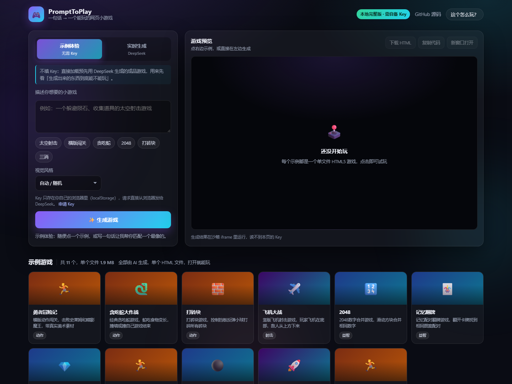
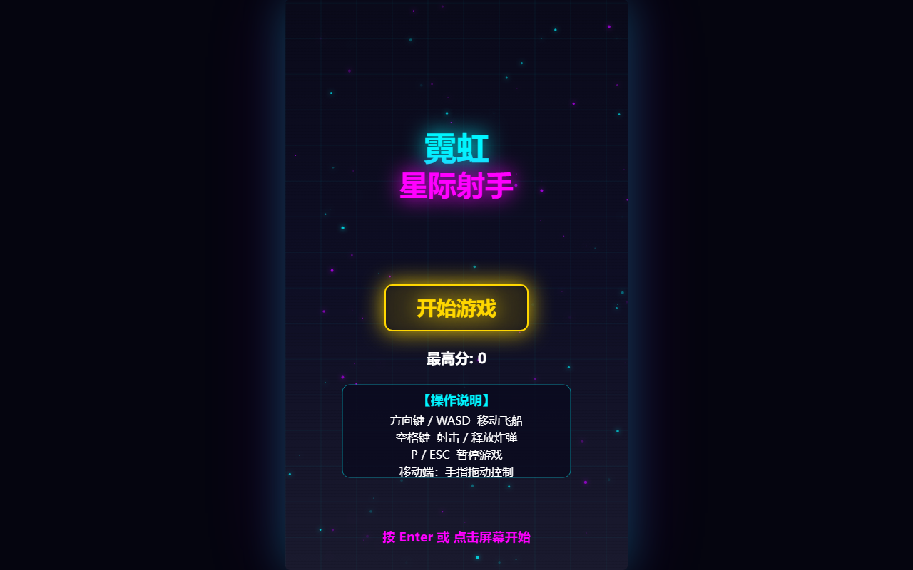

<div align="center">

# 🎮 PromptToPlay

**一句话，生成一个能玩的网页小游戏**

输入一句中文描述 → DeepSeek 写出一整份可玩的 HTML5 游戏代码 → 打开就能玩、能下载、能分享。

[](https://shuo-x1.github.io/prompttoplay/)
[](https://opensource.org/licenses/MIT)
[](https://nodejs.org/)
[](https://platform.deepseek.com/)

[在线试玩](#-在线体验) · [30 秒跑起来](#-30-秒跑起来本地) · [为什么之前跑不起来](#-为什么之前跑不起来已修) · [验证清单](#-验证清单照着做就能确认) · [项目结构](#-项目结构) · [技术栈](#-技术栈)

</div>

---

## 🕹 在线体验

**👉 https://shuo-x1.github.io/prompttoplay/**



| 你想做的事 | 怎么操作 | 需要 Key 吗 |
| --- | --- | --- |
| 看这东西到底能不能玩 | 打开链接，点任意示例游戏 | 不需要 |
| 输入一句话，生成一个新游戏 | 页面里填自己的 DeepSeek Key（浏览器本地保存，直连 `api.deepseek.com`） | 需要，自己的 |
| 完整体验产品（注册 / 积分 / 游戏大厅 / 充值） | 本地跑完整版：`npm start` 后访问 `http://localhost:3000` | 需要，配在 `.env` |

示例库里的游戏都是 DeepSeek 生成的产物，**没有手工改过一行代码**，直接以单文件 HTML 运行；实时生成一次约 20~60 秒，成本约 ¥0.03~0.1。



<sub>上面这张是 `web/demos/ai-shooter.html` 的真实运行画面：一次生成、49 秒、41 KB、0 行手工修改。</sub>

## ⚡ 30 秒跑起来（本地）

### Windows：双击 `启动.cmd`

会自动检查 Node、装依赖、启动服务并打开浏览器（地址是 `http://localhost:3000/demo`，**不需要 `.env`**）。

### 任意系统：三条命令

```bash
git clone https://github.com/shuo-x1/prompttoplay.git
cd prompttoplay
npm install && npm start
```

然后打开 **http://localhost:3000/demo** —— 在线体验版，不登录、不需要 Key，示例游戏直接能玩。
想用完整版（注册登录、积分、游戏大厅、充值）再访问 `http://localhost:3000`，这时才需要 `.env`：

```bash
# Windows PowerShell
Copy-Item .env.example .env
# macOS / Linux
cp .env.example .env
# 然后用编辑器把 DEEPSEEK_API_KEY 填进去
```

## 🔧 为什么之前跑不起来（已修）

之前 README 的四步在任何一台干净机器上都很容易卡住，逐条修了：

| 坑 | 现象 | 现在 |
| --- | --- | --- |
| `cp .env.example .env` | Windows 的 PowerShell / cmd 没有 `cp` 命令，第一步就报错 | README 按系统给命令；`启动.cmd` 完全不需要这一步 |
| 没配 `DEEPSEEK_API_KEY` | `server.js` 直接 `FATAL` + `process.exit(1)`，服务起不来 | 改成只打印警告并降级启动，体验版照样能用（Key 也可以由前端传） |
| 只想要个 demo 却要注册账号 | 生成接口挂了 JWT 校验，必须先注册登录 | 新增 `/api/demo/generate`：不登录、不写库、不扣配额，专门给体验页用 |
| Node 版本太老 | Node 16 没有全局 `fetch`，装 `sql.js` / 起服务就报错 | 启动脚本先检查版本；README 写明 Node ≥ 18 |
| 3000 端口被别的项目占用 | `EADDRINUSE` | `PORT=3100 npm start` 换端口 |

## ✅ 验证清单（照着做就能确认）

1. **服务活着**
   ```bash
   curl http://localhost:3000/api/health
   # {"status":"ok","uptime":2.1,"timestamp":"...","version":"1.0.0"}
   ```
2. **体验版代理可用**
   ```bash
   curl http://localhost:3000/api/demo/health
   # {"ok":true,"serverKey":false,"model":"deepseek-chat"}
   ```
3. **打开 http://localhost:3000/demo**，画廊里有 11 个游戏（9 个内置 + 2 个 DeepSeek 现场生成的示例），随便点一个：有开始界面、能操作、有音效、有暂停和结束结算。
4. **实时生成**：切到「实时生成」页签 → 填 Key → 输入「一个躲避陨石、收集道具的太空射击游戏」→ 状态栏会显示“正在生成…已收 xx KB”，完成后右侧出现新游戏；点「下载 HTML」，双击下载的文件应该能独立运行。
5. **完整版接口**：`curl http://localhost:3000/api/games` 返回 9 条内置游戏（JSON）。
6. **示例游戏批量自检**（不用开浏览器就能挡住“生成被截断 / 括号没闭合”）：
   ```bash
   npm run check-demos
   # 11/11 个游戏通过检查
   ```

## 📁 项目结构

```
prompttoplay/
├── web/                    # 🆕 在线体验版：纯静态，可直接部署到 GitHub Pages
│   ├── index.html          # 页面骨架
│   ├── app.js              # 示例体验 / 实时生成 / 沙箱预览 / 下载
│   ├── style.css           # 无框架、无外部字体
│   ├── prompt.js           # 🆕 提示词引擎（前后端共用的一份实现）
│   └── demos/              # 内置示例游戏（单文件 HTML）+ 清单 json
├── public/                 # 完整版前端页面（首页 / 大厅 / 个人中心 / 登录）
├── routes/                 # API 路由（auth / user / games / payment / share / demo）
│   └── demo.js             # 🆕 体验版免登录生成接口
├── services/               # DeepSeek 调用、封面、支付、水印
├── scripts/                # seed 游戏、导出示例、批量生成素材
├── server.js               # 入口（零配置也能启动）
├── 启动.cmd                # 🆕 Windows 一键启动
└── .env.example            # 完整版环境变量模板（体验版不需要）
```

`web/demos` 里的示例由 `npm run export-demos` 从 `scripts/seed-games.js` 导出，改完内置游戏重新跑一次即可。

## 🧠 开发方式说明（AI 辅助 + 人工验收）

这个项目是「AI 辅助开发」的实践样本，流程写在这里，方便对照代码评审：

1. **需求与架构由本人确定**：做什么产品、有哪些模块（认证 / 配额 / 支付 / 大厅 / 生成管线）、数据表怎么设计、部署到哪。
2. **提示词工程**是核心资产：`web/prompt.js` 里的类型识别、`Juice System` 手感清单、8 种视觉风格约束、输出格式硬要求，都是反复迭代出来的。
3. **代码主要由 AI 生成**，逐段读懂后验收：能讲清每个文件干什么、关键函数怎么走（例如 `routes/games.js` 的配额扣减与失败回滚、`services/deepseek.js` 的超时与截断处理）。
4. **问题是自己定位的**，例如：
   - 长游戏会撞 `max_tokens=16000` 被截断 → 现在会检测 `finish_reason === 'length'` 并明确报错，同时把提示词改成「必须完整写到 `</html>`」；
   - 浏览器的沙箱 iframe 里 `localStorage` 不可用会让游戏直接崩 → 在预览页注入内存版兜底；
   - 缺 Key 就退出、必须先注册才能试用 → 拆出 `/api/demo/generate` 免登录通道。
5. **每个改动都跑一遍验证清单**（见上一节），不靠“看起来没问题”。

## ✨ 功能特性

| 功能 | 说明 |
| --- | --- |
| 🤖 **AI 游戏生成** | 基于 DeepSeek API，输入描述即可生成完整 HTML5 游戏 |
| 🕹️ **在线体验版** | 纯静态页面，GitHub Pages 直接托管；示例免 Key 可玩，也可用自带 Key 实时生成 |
| 🎯 **内置示例游戏** | 9 个内置 + 2 个现场生成的示例，首次启动自动 seed，开箱即用 |
| 👤 **用户系统** | 注册 / 登录 / JWT 认证，个人中心管理游戏 |
| 💎 **积分配额体系** | 免费版 3 次/天，Pro 版 $9.90/月 400 次，企业版 3000 次/月 |
| 🔗 **分享 & 邀请奖励** | 分享 +1 次/天，邀请好友首次生成 +1 次 |
| 💳 **积分与充值** | 积分扣减、充值套餐、订单与流水表；目前是 `DEV_MODE` 模拟到账，真实支付渠道未接（见路线图） |
| 🚀 **多种部署方式** | GitHub Pages（体验版）、Zeabur（国内推荐）、Fly.io、Docker |
| 📦 **零配置数据库** | SQLite 自动初始化，无需安装数据库 |

## 🎯 它能生成什么游戏？

- 贪吃蛇、俄罗斯方块、2048 等经典休闲游戏
- 打砖块、飞机大战、射击类游戏
- 迷宫、解谜、益智类游戏
- 平台跳跃、跑酷游戏
- 卡牌、文字冒险类游戏

> 生成的游戏为单文件 HTML，可直接在浏览器运行，也可下载分享。

## ⚙️ 环境变量

体验版（`/demo`）**不需要任何环境变量**。完整版按需配置：

| 变量 | 必填 | 默认值 | 说明 |
| --- | --- | --- | --- |
| `DEEPSEEK_API_KEY` | 完整版需要 | — | DeepSeek 密钥；不填时服务仍会启动，体验版需用户自己填 Key |
| `JWT_SECRET` | ❌ | 启动时随机生成 | JWT 签名密钥（生产建议固定，否则重启后登录态失效） |
| `DEEPSEEK_API_BASE` | ❌ | `https://api.deepseek.com/v1` | 可换成中转地址 |
| `DEEPSEEK_MODEL` | ❌ | `deepseek-chat` | 模型名 |
| `DEEPSEEK_MAX_TOKENS` | ❌ | `32000` | 单次生成上限；太小会截断长游戏 |
| `PORT` | ❌ | `3000` | 服务端口 |
| `DOMAIN` | ❌ | — | 公开域名（分享链接等需要） |
| `NODE_ENV` | ❌ | `development` | 运行环境 |
| `DEV_MODE` | ❌ | `true` | 开发模式：支付直接到账，仅本地用 |

## 💎 配额系统

| 套餐 | 价格 | 生成次数 | 额外获取方式 |
| --- | --- | --- | --- |
| **Free** | 免费 | 3 次 / 天 | 分享 +1/天，邀请 +1/次 |
| **Pro** | $9.90 / 月 | 400 次 / 月 | — |
| **Enterprise** | 联系定制 | 3000 次 / 月 | 专属支持 |

## 📦 部署

- **体验版（web/）**：已发布在 GitHub Pages → <https://shuo-x1.github.io/prompttoplay/>，发布源是 `gh-pages` 分支（内容就是 `web/`，不要直接改它）。改完 `web/` 后运行 `npm run deploy`（等价于 `git subtree push --prefix web origin gh-pages`）即可更新；也可以把 `web/` 丢到任何静态托管（Vercel / Netlify / 对象存储）。
  > Pages 只能托管静态文件：体验版里的实时生成是浏览器直连 DeepSeek，访问者要自己填 Key。想让访问者**不用填 Key** 就能生成，需要把完整版部署到 Zeabur / Fly（Key 留在服务端）。
- **完整版**：见 [DEPLOY.md](./DEPLOY.md)，含 Zeabur、Fly.io、Docker、内网穿透四种方案；也提供 `deploy-zeabur.bat` / `deploy-fly.bat` 一键脚本。

## 🛠 技术栈

| 层级 | 技术 |
| --- | --- |
| 后端 | Node.js 18+ / Express |
| 数据库 | SQLite（sql.js，纯 JS 实现，无原生依赖） |
| 前端 | 原生 HTML / CSS / JavaScript，零构建 |
| 提示词 | 共用 `web/prompt.js`：类型识别 + 手感系统 + 视觉风格 + 输出约束 |
| AI | DeepSeek API（`deepseek-chat`） |
| 认证 | JWT + bcryptjs |
| 计费 | 积分 / 订单流水（SQLite 表）+ `DEV_MODE` 模拟到账；真实支付渠道待接入 |
| 部署 | GitHub Pages / Zeabur / Fly.io / Docker |

## 🗺 路线图

- [x] AI 游戏生成核心功能
- [x] 在线体验版（免安装、免 Key 试玩）
- [x] 零配置启动 + Windows 一键启动脚本
- [x] 提示词前后端共用、输出截断检测
- [x] 用户系统与 JWT 认证
- [x] 积分配额（充值包 / 订单 / 流水；`DEV_MODE` 模拟到账）
- [x] 分享 & 邀请奖励
- [x] 内置示例游戏
- [ ] 接入真实支付渠道（Stripe / 微信支付），替换模拟到账
- [ ] 游戏模板市场（用户分享自制游戏）
- [ ] 多人在线对战支持
- [ ] 游戏导出为 APK / 小程序
- [ ] 支持更多 AI 模型（GPT、Claude 等）
- [ ] 游戏编辑器（可视化微调生成结果）

## 🤝 贡献

1. Fork 本仓库
2. 创建特性分支（`git checkout -b feature/AmazingFeature`）
3. 提交改动（`git commit -m 'feat: xxx'`）
4. 推送并开 Pull Request

## 📄 许可证

[MIT License](./LICENSE)

---

<div align="center">

如果这个项目对你有帮助，欢迎给个 ⭐ Star 支持一下！

Made with ❤️ by [shuo-x1](https://github.com/shuo-x1)

</div>
